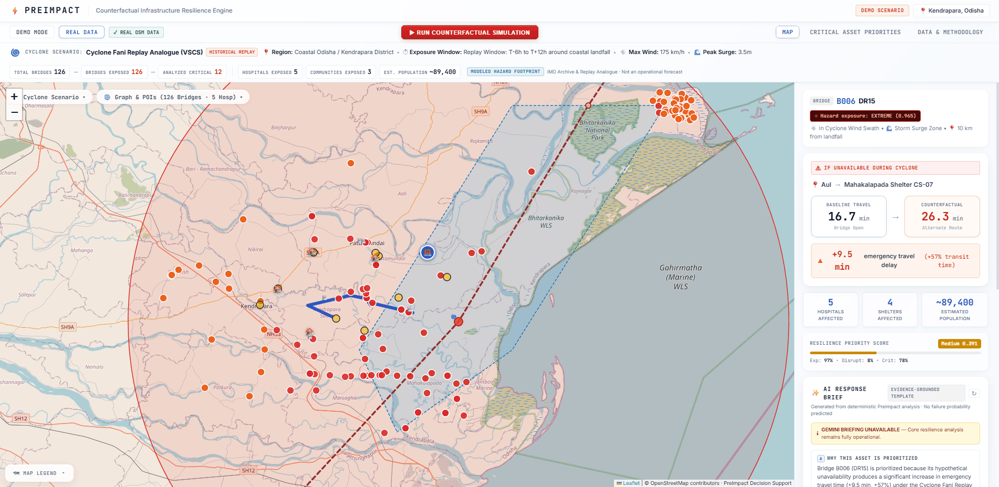
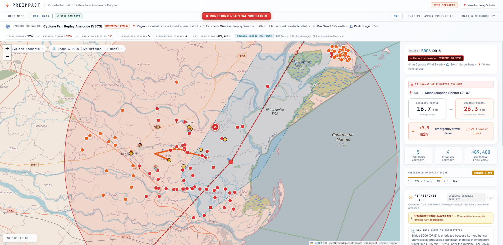

# PreImpact
## Counterfactual Infrastructure Resilience Engine

> We don't predict that infrastructure will fail.
> We show responders what happens if it does — before the cyclone arrives.

[](#automated-testing)
[](#data-provenance--transparency)
[](#proof-of-concept-results)
[](#technologies-used)
[](#license)

---

## 1. Overview

**PreImpact** is a pre-disaster decision-support engine designed for coastal disaster responders and district incident commanders. Traditional disaster management either attempts structural collapse predictions (which require unavailable physical sensor telemetry) or presents static hazard overlays that lack routing awareness. 

PreImpact shifts the paradigm from failure prediction to **actionable consequence analysis**: it evaluates the systemic impact of hypothetical infrastructure unavailability on emergency corridors before a cyclone makes landfall.

> **IMPORTANT DISCLAIMER:**
> PreImpact evaluates hypothetical infrastructure unavailability under a modeled cyclone scenario and quantifies the resulting emergency-access disruption. **IMPORTANT: PreImpact does not predict structural failure probability.**

### Problem Addressed
During severe cyclonic events in coastal Odisha, emergency responders face critical operational questions:
- *If a key river crossing is submerged or cut off, which hospitals and shelters lose access?*
- *How much longer will an ambulance take to reach trauma care via alternate detours?*
- *Which specific bridges should district officials inspect and pre-position rescue personnel at before landfall?*

PreImpact answers these questions deterministically through in-memory graph routing and hazard exposure modeling, synthesized into concise operational briefs via Google Gemini 2.5 Flash.

---

## Product Preview

### Real-world decision view


PreImpact combines the cyclone scenario, real OSM infrastructure, and the selected critical asset in one decision view.

### Counterfactual result


A hypothetical bridge unavailability scenario is simulated and the resulting emergency-access disruption is quantified.

### Data provenance and methodology


The interface distinguishes real, modeled, and estimated information and makes the evidence boundary visible.

---

## 2. Proof of Concept Results

PreImpact was validated on **Kendrapara District, Odisha**, an extremely flood-prone coastal region bordering the Bay of Bengal, using a historical replay analogue of **Cyclone Fani (May 2019)**:

| Metric | Tested Value | Operational Meaning |
|---|---|---|
| **Selected Asset** | **Bridge B006 (DR15 Crossing)** | Key bridge on District Road 15 connecting coastal villages |
| **Baseline Travel Time** | **16.7 min** | Direct access to district healthcare under normal open conditions |
| **Scenario Travel Time** | **26.3 min** | Rerouted detour travel time when Bridge B006 is hypothetically unavailable |
| **Disruption Delta ($\Delta t$)** | **+9.5 min** (+57.1%) | Acute emergency-access delay added to critical hospital routes |
| **Downstream Hospitals Affected** | **5 facilities** | District Hospital Kendrapara, Community Health Centers, Sub-divisional clinics |
| **Downstream Shelters Affected** | **4 shelters** | Cyclone shelters serving high-vulnerability coastal blocks |
| **Estimated Population Affected** | **~89,400 residents** | Aggregate population dependent on the severed corridor |
| **Hazard Exposure Score ($E$)** | **0.965** (Extreme) | Bridge lies in the direct coastal surge zone and 45 km core wind swath |
| **Resilience Priority Score ($P$)** | **0.391** (Elevated) | Balanced geometric mean ranking Bridge B006 as a top pre-positioning priority |

---

## 3. System Architecture & Data Flow

PreImpact executes an end-to-end deterministic simulation pipeline before generating evidence-grounded AI briefs:

```
Cyclone Scenario (Historical Replay Analogue — Cyclone Fani 2019)
      ↓
Hazard Footprint (Core wind swath 45 km, gale swath 85 km, storm surge polygon)
      ↓
Candidate Assets (OSM bridges filtered by proximity and exposure: 126 total → 126 exposed → 12 critical)
      ↓
Counterfactual Simulation (Hypothetical edge removal on in-memory NetworkX graph)
      ↓
Network Rerouting & Travel Time Delta (Dijkstra recalculation: Δt = t_scenario - t_baseline)
      ↓
Impact Aggregation (Downstream hospitals, shelters, and isolated population calculation)
      ↓
Resilience Priority Scoring (Geometric mean: P = (Exposure × Disruption × Criticality)^(1/3))
      ↓
Evidence-Grounded Gemini Briefing (Operational preparation options synthesized from engine facts)
```

### Component Breakdown
1. **Hazard Exposure Engine:** Calculates geographic distance to track centerline and landfall, checks point-in-polygon containment for storm surge inundation, and assigns normalized exposure scores $E \in [0.0, 1.0]$.
2. **Counterfactual Graph Engine:** Maintains an in-memory `MultiDiGraph` of the road network using NetworkX. Simulates unavailability by isolating the asset's subgraph edges without mutating base data.
3. **Routing & Disruption Recalculator:** Executes Dijkstra shortest-path queries across all settlement-to-facility OD pairs to measure travel-time inflation and detect complete severance.
4. **Resilience Priority Scorer:** Evaluates multi-criteria priority using geometric mean formulation to eliminate single-factor distortion.
5. **AI Briefing Layer:** Translates deterministic facts into actionable pre-impact operational preparation options using Google Gemini 2.5 Flash.

---

## 4. Data Sources & Provenance Transparency

PreImpact enforces complete institutional transparency by explicitly categorizing and labeling all data layers as **REAL**, **MODELED**, or **ESTIMATED**:

| Category | Layer | Source & Verification | Modeled vs Real Status |
|---|---|---|---|
| **REAL** | **Road Network** | OpenStreetMap genuine download (OSMnx) | Genuine network: 1,672 nodes, 4,115 edges in Kendrapara |
| **REAL** | **Bridges** | OpenStreetMap `bridge=yes` tags | 126 independently verified OSM bridges detected |
| **REAL** | **Healthcare Facilities** | OpenStreetMap `amenity=hospital` | 5 verified hospital facilities with OSM IDs and coordinates |
| **MODELED** | **Cyclone Scenario** | IMD Archive Analogue (Cyclone Fani) | Historical replay analogue (**not an operational forecast**) |
| **MODELED** | **Hazard Footprint** | Geometric track buffer & surge polygon | Core wind swath (45 km), gale swath (85 km), surge zone polygon |
| **MODELED** | **Bridge Unavailability** | Counterfactual edge removal | Hypothetical scenario simulation (**not structural failure prediction**) |
| **MODELED** | **Route Recalculation** | NetworkX Dijkstra algorithm | Shortest travel-time detour under speed-limit assumptions |
| **MODELED** | **Resilience Priority** | Formula: $(E \times D \times C)^{1/3}$ | Balanced score combining exposure, disruption, and criticality |
| **ESTIMATED** | **Shelters** | Fallback geographic coordinates | 4 cyclone shelters in coastal service corridor |
| **ESTIMATED** | **Population** | District census aggregate estimates | ~89,400 residents across Kendrapara coastal settlements |
| **EVIDENCE-GROUNDED** | **Operational Briefing** | Google Gemini 2.5 Flash | Grounded strictly on deterministic engine facts (deterministic fallback if offline) |

---

## 5. Technologies Used

PreImpact is implemented with a lightweight, reproducible open-source stack:

- **Python (3.11+):** Core graph routing, hazard exposure mathematics, and backend services.
- **NetworkX:** In-memory road graph representation, subgraph isolation, edge removal, and Dijkstra shortest-path recalculation.
- **FastAPI & Uvicorn:** High-performance RESTful backend API serving simulation results and POI datasets.
- **React (18) & Vite:** Component-based frontend interface with light soft glassmorphism architecture.
- **Leaflet:** Interactive geospatial visualization of cyclone tracks, wind swaths, surge zones, bridges, and counterfactual routes.
- **Google Gemini Integration (`google-genai` SDK):** Gemini 2.5 Flash used exclusively as an evidence-grounded operational briefing layer.
- **OpenStreetMap Data (OSMnx / Overpass):** Genuine road network geometry, bridge tags, and healthcare facility locations for Kendrapara, Odisha.

> **TECHNOLOGY BOUNDARY NOTE:**
> PreImpact uses **ONLY** the technologies listed above. It does not use, require, or claim external services like Google Earth Engine, BigQuery, Vertex AI, Bayesian belief networks, or Graph Neural Networks (GNNs).

---

## 6. Quick Start & Local Execution

### Prerequisites
- Python 3.11+
- Node.js 18+ and npm

### 1. Clone Repository
```bash
git clone https://github.com/PhantomCipher13/preimpact.git
cd preimpact
```

### 2. Install Backend Dependencies
```bash
pip install -r requirements.txt
```

### 3. Configure Environment (Optional)
```bash
cp .env.example .env
```
*(PreImpact works 100% offline with deterministic fallback templates if no Gemini API key is provided.)*

### 4. Start Backend API
```bash
python -m uvicorn backend.api.main:app --host 127.0.0.1 --port 8000
```
- API interactive docs: `http://127.0.0.1:8000/docs`
- Health check: `http://127.0.0.1:8000/api/health`

### 5. Start Frontend Dashboard
In a separate terminal:
```bash
cd frontend
npm install
npm run dev
```
Open `http://localhost:5173` or `http://127.0.0.1:5173` in your browser.

---

## 7. Automated Testing & Verification

PreImpact includes a comprehensive automated test suite covering all mathematical formulations, graph manipulation, API contracts, and edge cases:

```bash
# Run backend pytest suite (118 unit & integration tests)
python -m pytest tests/ -v
```

**Results:**
- **118 passed** in ~3.7 seconds.
- 100% offline execution (zero external network dependency required).

### Production Frontend Build Verification
```bash
cd frontend
npm run build
```
- Vite production build compiles with 0 errors and output bundles in `frontend/dist/`.

---

## 8. Responsible AI & Guardrails

PreImpact was built adhering to strict institutional disaster-response ethics:

1. **Strict Evidence Grounding:** Gemini receives ONLY structured, pre-computed facts from the engine (asset ID, baseline time, scenario time, delay delta, affected hospital/shelter counts, population).
2. **Zero Hallucination Guardrails:** The prompt explicitly forbids inventing facilities, adjusting travel times, or speculating on bridge collapse.
3. **Operational Decision Support Only:** Gemini synthesizes 5 pre-impact preparation options (ambulance pre-positioning, culvert inspections, supply staging, corridor monitoring, command coordination). It cannot issue autonomous evacuation or road closure orders.
4. **Graceful Offline Degradation:** If `GEMINI_API_KEY` is omitted or API calls fail/timeout, PreImpact automatically provides a deterministic evidence template. The core resilience engine remains 100% operational.

---

## 9. Limitations & Current Scope

To maintain scientific integrity, PreImpact explicitly discloses current limitations:
- **Single-Bridge Counterfactual:** The current simulation removes one candidate bridge at a time to evaluate isolated vulnerability. Multi-bridge simultaneous cascading failure is planned for future releases.
- **Static Travel Times:** Speeds are derived from OSM road classifications and design limits. Dynamic water depth impedance and congestion surges are not yet dynamically coupled.
- **Historical Replay Analogue:** Cyclone footprints are modeled from historical IMD analogues (Cyclone Fani) for contingency planning, not live meteorological feeds.
- **Single Mode:** Network analysis focuses on terrestrial road networks; multimodal access (boats, air transport) is excluded.
- **Census Approximations:** Population figures are derived from administrative block census aggregates.

---

## 10. Future Work

Pragmatic engineering next steps for PreImpact:
- **Dynamic Inundation-Depth Impedance:** Integrating hydrodynamic water depth curves where travel speed decays continuously as floodwater rises: $v(d) = v_0 \cdot \max(0, 1 - (d / d_{crit}))$.
- **Multi-Asset Combinatorial Analysis:** Evaluating simultaneous failures of adjacent culverts and bridges along critical evacuation corridors.
- **Live IMD / Sensor Feeds:** Integrating real-time river gauge telemetry and IMD cyclone track advisories.
- **Multimodal Evacuation Routing:** Incorporating inland water transport and air drop staging points when road corridors are severed.

---

## 11. Links & Resources

- **GitHub Repository:** [https://github.com/PhantomCipher13/preimpact](https://github.com/PhantomCipher13/preimpact)
- **Demo Video (Google Drive):** [Watch Demo Video on Google Drive](https://drive.google.com/file/d/1-xrf2_acIjGR-FG-qxlwYF-0pJ7UF449/view?usp=drivesdk)
- **Demo Video (Repository):** [`preimpact_demo.mp4`](./preimpact_demo.mp4) — Synchronized walkthrough demonstrating the live interface, 3-phase simulation lifecycle, and Gemini briefing.
- **Technical Report:** [`TECHNICAL_REPORT.md`](./TECHNICAL_REPORT.md) — Comprehensive technical documentation, mathematical derivations, and architecture details.
- **API Documentation:** Interactive Swagger UI available at `http://127.0.0.1:8000/docs` when running the backend.

---

## 12. License

This project is licensed under the MIT License. See [LICENSE](LICENSE) for details.
